# Raport z zadania 1
## Cel ćwiczenia
Celem ćwiczenia było pobranie odpowiednich map satelitarnych z platformy [Copernicus Browser](https://browser.dataspace.copernicus.eu/), a następnie przygotowanie mapy z wizualizacją wskaźnika NDVI.

## Przebieg ćwiczenia
W serwisie  [Copernicus Browser](https://browser.dataspace.copernicus.eu/) zaznaczono wybrany fragment mapy satelitarnej (Rys. 1). Następnie w zakładce **Analytical** pobrano dane rastrowe odpowiadające dwóm pasmom spektralnym: **B04 (RED)** — pasmo czerwone, oraz **B08 (NIR)** — bliską podczerwień (Rys. 2).

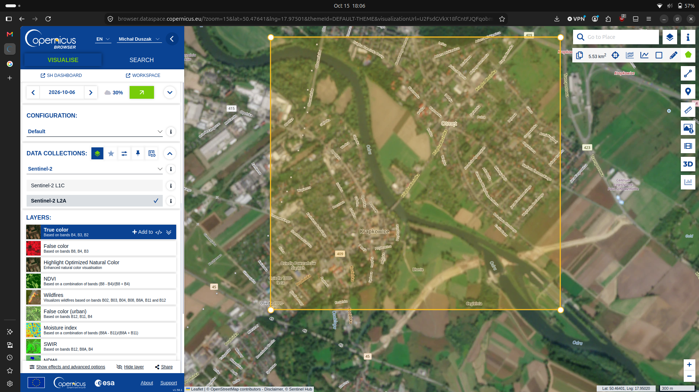
*Rys. 1. Zaznaczenie obszaru w serwisie Copernicus*

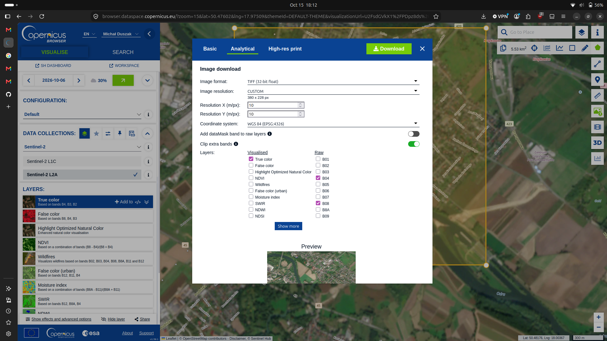
*Rys. 2. Pobieranie pasm spektralnych w Copernicus Browser.*

Pobrane rastry zaimportowano do nowego projektu QGIS i nazwano `b04` (Rys. 3) oraz `b08` (Rys. 4). W narzędziu **Raster → Raster Calculator** obliczono wskaźnik NDVI (Rys. 5) zgodnie ze wzorem:

$$
NDVI = \frac{NIR - RED}{NIR + RED}
$$

*Rys. 3. Warstwa `b04` w programie QGIS.*

*Rys. 4. Warstwa `b04` w programie QGIS.*

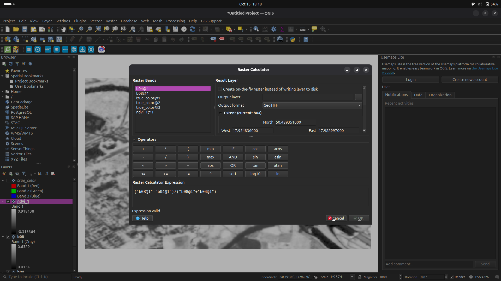
*Rys. 5. Narzędzie **Raster Calculator***

Wynik oobliczeń zapisano w nowej warstwie nazwanej `ndvi` (Rys. 6).

*Rys. 6. Warstwa NDVI.*

Dla otrzymanej warstwy zmieniono sposób wyświetlania na **Singleband pseudocolor**, aby uwidocznić zróżnicowanie wartości NDVI (Rys. 7). Przyjęto zakres wizualizacji od −0,1 do 0,92 (Rys. 8).

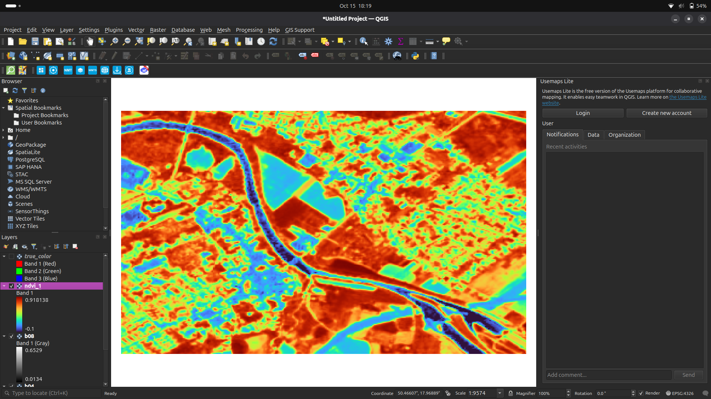
*Rys. 7. Wizualizacja otrzymanego wskaźnika NDVI.*

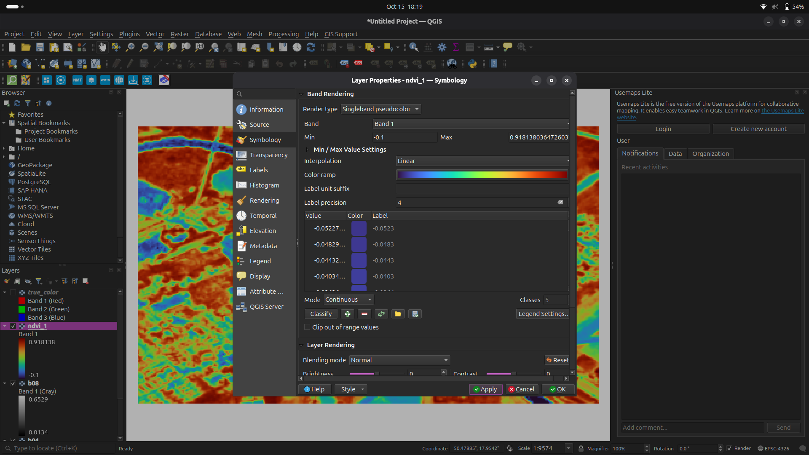
*Rys. 8. Konfiguracja właściwości **Symbology** warstwy NDVI.*

## Wyniki i wnioski

Uzyskano mapę przedstawiającą przestrzenne zróżnicowanie wskaźnika NDVI na wybranym obszarze. Wartości wyższe są zazwyczaj związane z obecnością aktywnej roślinności, natomiast niskie lub ujemne mogą odpowiadać m.in. zabudowie, odkrytej glebie i wodzie. Przyjęta paleta barw pozwala łatwiej odróżnić poszczególne obszary, jednak kolory należy interpretować zgodnie z przyjętą skalą. Dla porównania mapa w kolorach naturalnych. Uzysiane wyniki są zgodne z obserwacjami wynikającymi z porównania mapy satelitarną w kolorach widzialnych przez ludzkie oko (Rys. 9).

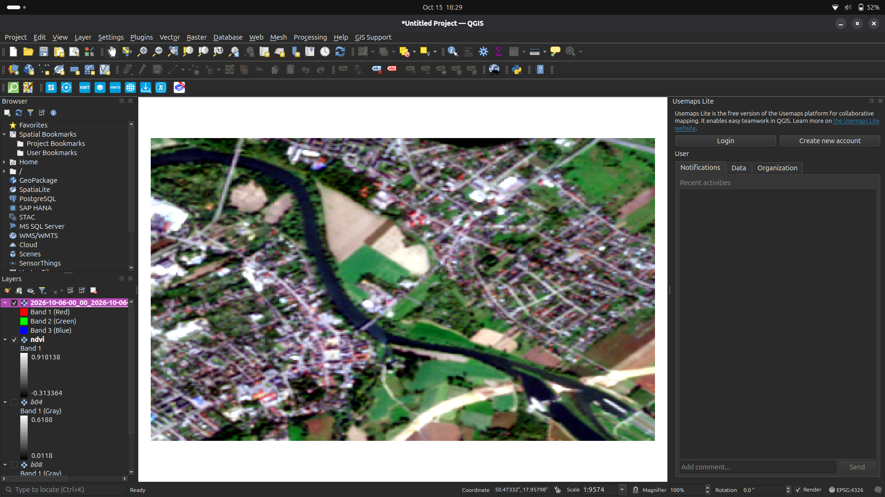

*Rys. 9. Obraz w barwach naturalnych do porównania z mapą NDVI.*

## Druga część ćwiczenia — mapa w wysokiej rozdzielczości i statystyka strefowa

W drugiej części ćwiczenia wykorzystano dane z Geoportalu. Wybrano ortofotomapę w barwach CIR (Color Infrared) dla arkusza `M-33-60-B-b-1-1`. Dane miały rozdzielczość piksela 0,25 m, układ współrzędnych PL-1992 oraz aktualność 2025-06-14. W panelu Geoportalu widoczna była informacja, że jest to obraz o pikselu powyżej 10 cm, udostępniony w sekcji dotyczącej danych o wysokiej rozdzielczości (Rys. 10).

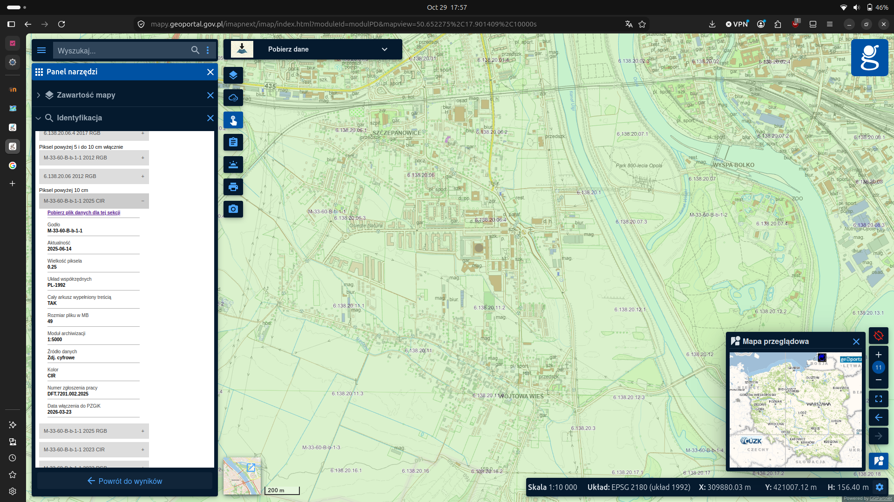
*Rys. 10. Wybór ortofotomapy CIR o wysokiej rozdzielczości w Geoportalu.*

Pobrany obraz zaimportowano do QGIS. Następnie, korzystając z narzędzia **Raster Calculator**, obliczono wskaźnik NDVI według wzoru:

$$
NDVI = \frac{NIR - RED}{NIR + RED}
$$

W wyrażeniu kalkulatora użyto odpowiednich kanałów obrazu odpowiadających promieniowaniu w bliskiej podczerwieni oraz w paśmie czerwonym. Wynik zapisano jako warstwę rastrową `ndvi` w formacie GeoTIFF (Rys. 11). Zastosowane wyrażenie było poprawne, co potwierdza komunikat **Expression valid**.

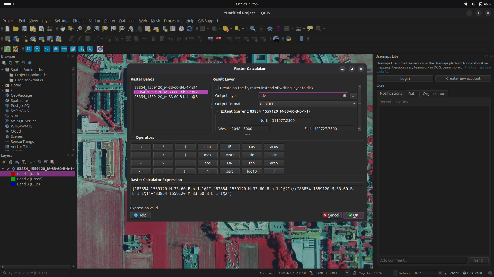
*Rys. 11. Obliczanie wskaźnika NDVI za pomocą narzędzia **Raster Calculator**.*

Po wykonaniu obliczeń na mapie wyświetlono warstwę źródłową CIR (Rys. 12) oraz wynikową warstwę NDVI (Rys. 13). Na obrazie CIR roślinność jest przedstawiona w odcieniach czerwieni, natomiast na rastrze NDVI wysokie wartości wskaźnika wyróżniono kolorem zielonym.

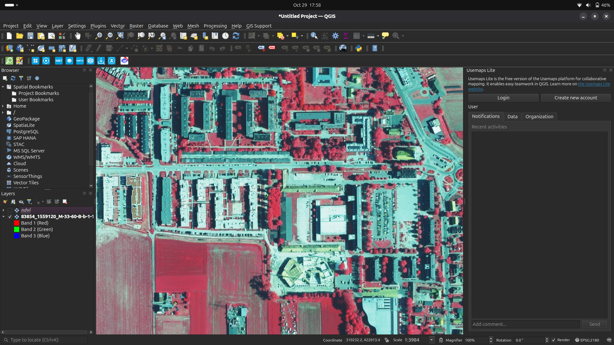
*Rys. 12. Obraz CIR o wysokiej rozdzielczości zaimportowany do QGIS.*

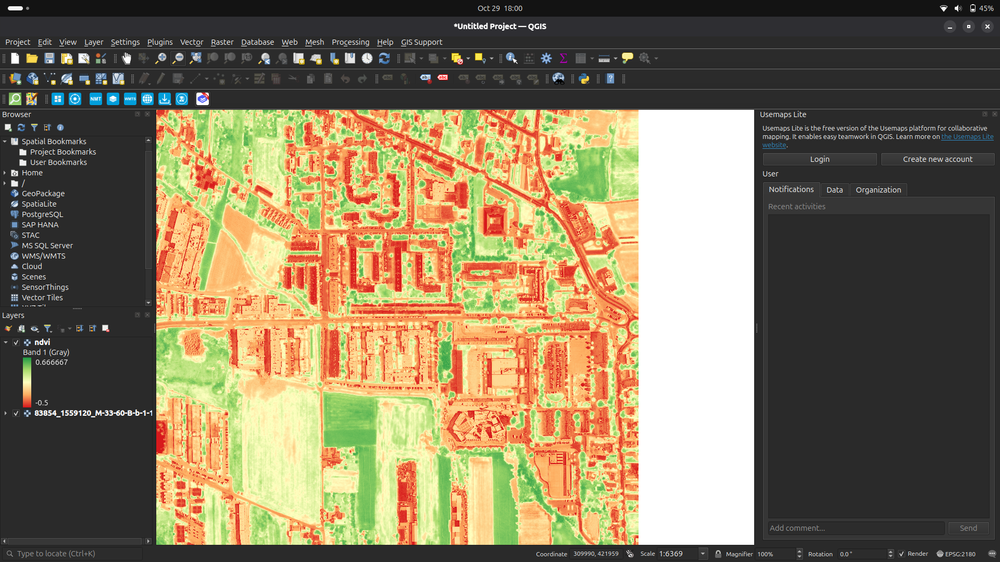
*Rys. 13. Wizualizacja rastra NDVI obliczonego na podstawie obrazu CIR.*

### Dodanie obszarów wektorowych i zonal statistics

W celu porównania wartości NDVI w wybranych częściach obszaru utworzono warstwę poligonową `polygons`. Dodano trzy poligony obejmujące różne typy pokrycia terenu widoczne na obrazie CIR: obszar z roślinnością, obszar o pośrednim udziale roślinności oraz obszar zabudowany lub utwardzony (Rys. 14). Poligony zostały nałożone na raster NDVI (Rys. 15), dzięki czemu można było obliczyć statystyki wyłącznie dla pikseli znajdujących się w granicach każdego z obszarów.

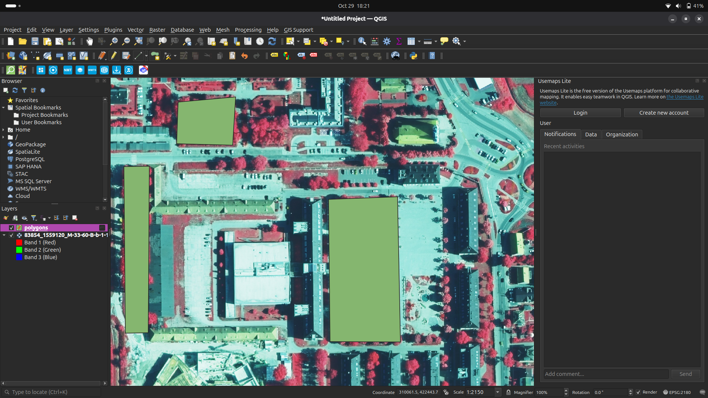
*Rys. 14. Trzy przykładowe obszary wektorowe na obrazie CIR.*

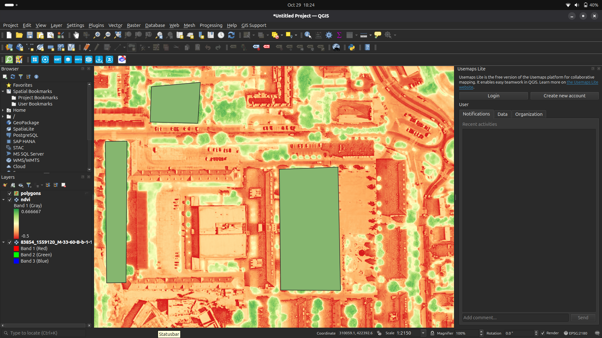
*Rys. 15. Położenie poligonów na tle rastra NDVI.*

Dla warstwy poligonowej wykonano algorytm **Raster layer zonal statistics**. Jako raster wejściowy wskazano warstwę `ndvi`, a obliczaną statystyką była średnia wartość NDVI (`_mean`) dla każdego poligonu. Otrzymane wartości wykorzystano następnie do stylizacji warstwy metodą **Graduated**. Zastosowano pięć klas kwantylowych, których granice widoczne w legendzie obejmowały zakres od około −0,13 do 0,297 (Rys. 16). Taki sposób klasyfikacji pozwala porównać poligony względem siebie, nawet gdy ich powierzchnie i liczba pikseli są różne.

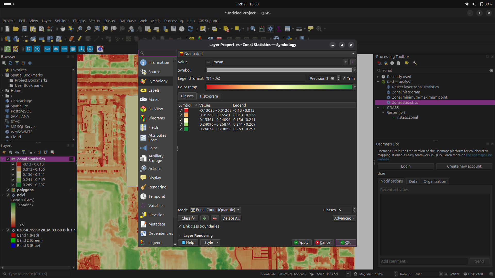
*Rys. 16. Klasyfikacja stopniowana statystyki `_mean` obliczonej dla poligonów.*

Na końcowej mapie każdy poligon otrzymał kolor odpowiadający klasie średniej wartości NDVI (Rys. 17). Najwyższa klasa, od około 0,269 do 0,297, wskazuje obszar o największym średnim udziale aktywnej roślinności. Najniższa klasa, od około −0,13 do 0,013, odpowiada obszarowi o bardzo małej aktywności roślinności, typowemu dla powierzchni zabudowanych, dróg lub innych powierzchni utwardzonych. Pozostały poligon należy do klasy pośredniej, co wskazuje na umiarkowane zróżnicowanie pokrycia terenu.

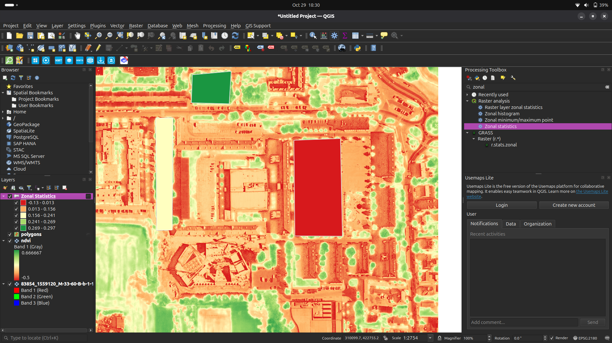
*Rys. 17. Wynik zonal statistics przedstawiony za pomocą barw odpowiadających klasom średniego NDVI.*

Wykonana analiza pokazuje, że statystyka strefowa umożliwia przejście od ogólnej mapy rastrowej do porównania konkretnych obszarów. Średnia wartość NDVI jest syntetyczną miarą charakteru pokrycia terenu w granicach poligonu: wartości wyższe wskazują na większy udział zdrowej roślinności, a wartości niskie lub ujemne na przewagę zabudowy, dróg, dachów, odkrytej gleby albo innych powierzchni o małej aktywności fotosyntetycznej. Dzięki rozdzielczości 0,25 m analiza pozwoliła uchwycić zróżnicowanie niewielkich obiektów, które byłoby trudniejsze do rozpoznania na obrazie o mniejszej rozdzielczości.
