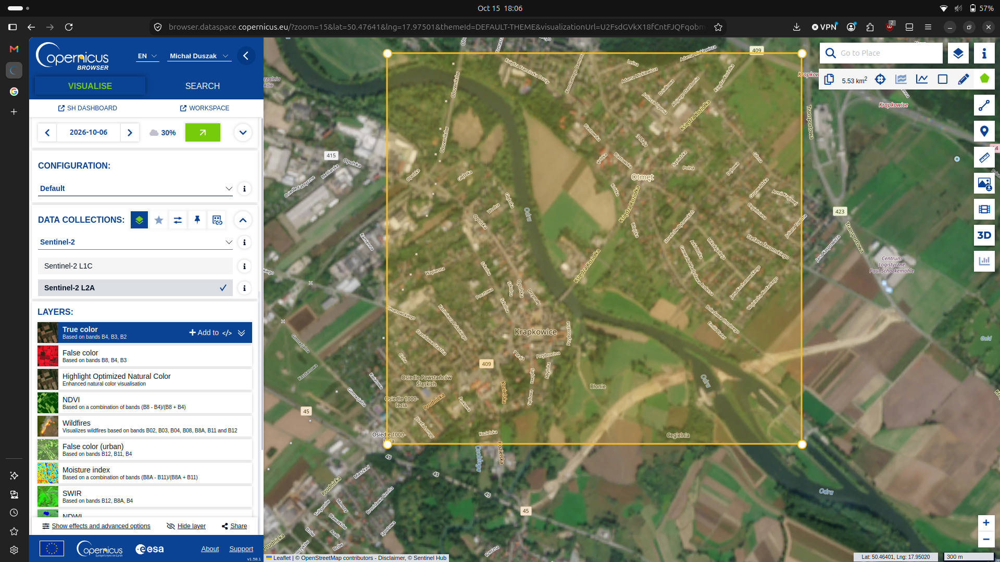
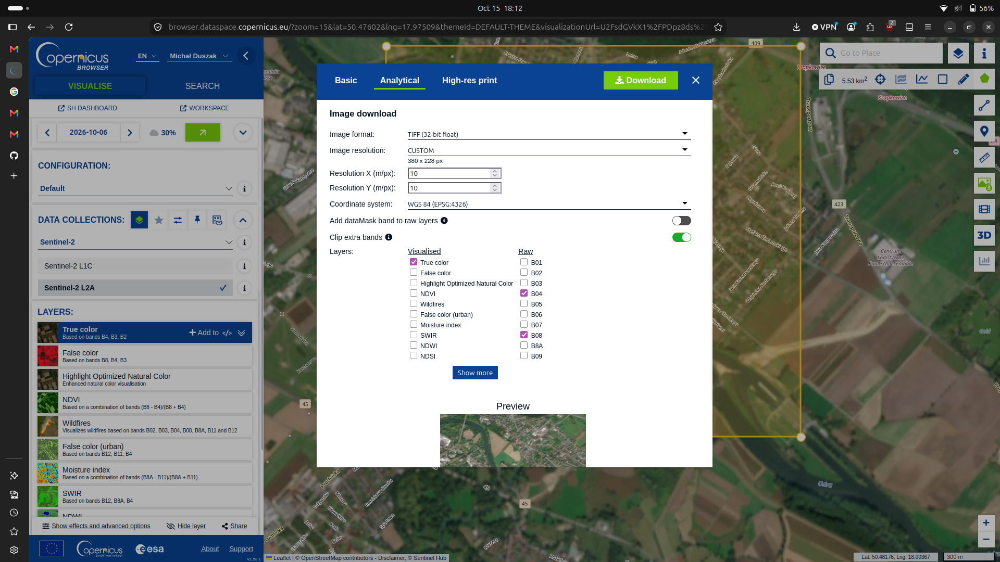
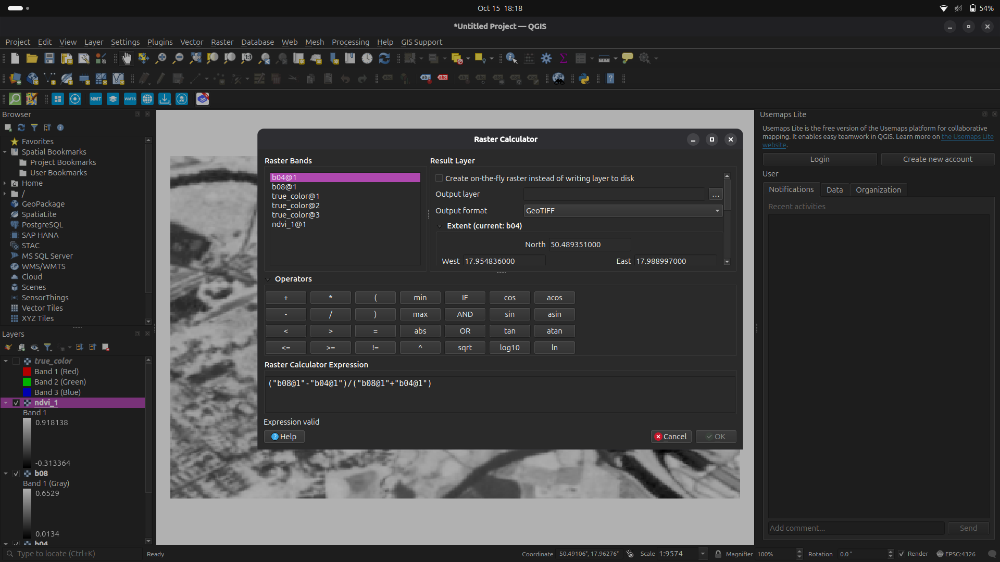
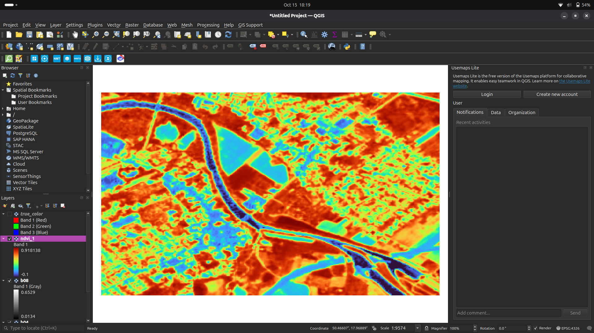
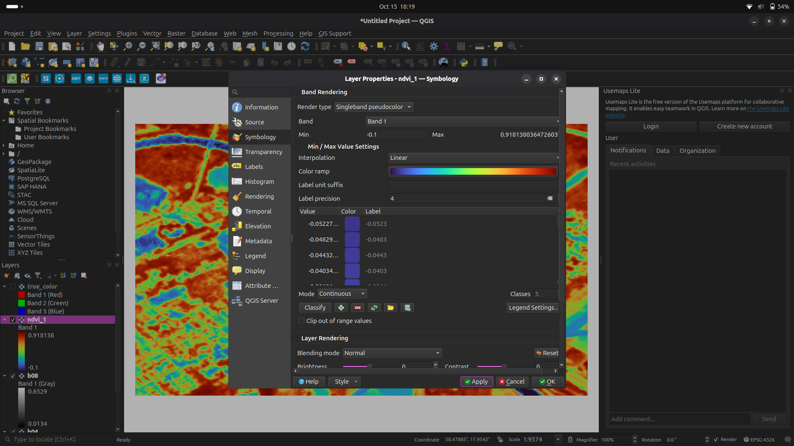
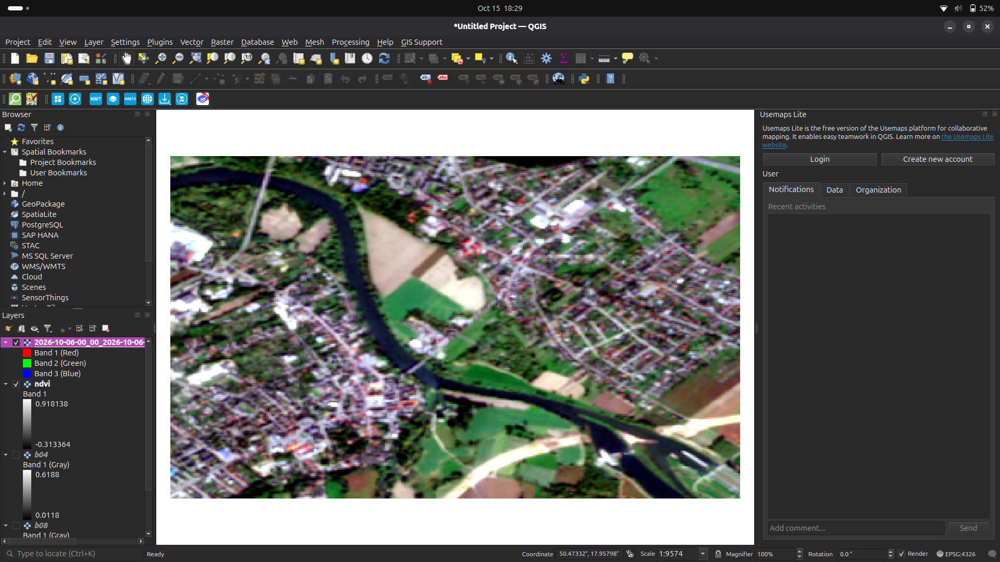

# Raport z zadania 1
## Cel ćwiczenia
Celem ćwiczenia było pobranie odpowiednich map satelitarnych z platformy [Copernicus Browser](https://browser.dataspace.copernicus.eu/), a następnie przygotowanie mapy z wizualizacją wskaźnika NDVI.

## Przebieg ćwiczenia
W serwisie  [Copernicus Browser](https://browser.dataspace.copernicus.eu/) zaznaczono wybrany fragment mapy satelitarnej (Rys. 1). Następnie w zakładce **Analytical** pobrano dane rastrowe odpowiadające dwóm pasmom spektralnym: **B04 (RED)** — pasmo czerwone, oraz **B08 (NIR)** — bliską podczerwień (Rys. 2).

*Rys. 1. Zaznaczenie obszaru w serwisie Copernicus*

*Rys. 2. Pobieranie pasm spektralnych w Copernicus Browser.*

Pobrane rastry zaimportowano do nowego projektu QGIS i nazwano `b04` (Rys. 3) oraz `b08` (Rys. 4). W narzędziu **Raster → Raster Calculator** obliczono wskaźnik NDVI (Rys. 5) zgodnie ze wzorem:

$$
NDVI = \frac{NIR - RED}{NIR + RED}
$$

*Rys. 3. Warstwa `b04` w programie QGIS.*

*Rys. 4. Warstwa `b04` w programie QGIS.*

*Rys. 5. Narzędzie **Raster Calculator***

Wynik oobliczeń zapisano w nowej warstwie nazwanej `ndvi` (Rys. 6).

*Rys. 6. Warstwa NDVI.*

Dla otrzymanej warstwy zmieniono sposób wyświetlania na **Singleband pseudocolor**, aby uwidocznić zróżnicowanie wartości NDVI (Rys. 7). Przyjęto zakres wizualizacji od −0,1 do 0,92 (Rys. 8).

*Rys. 7. Wizualizacja otrzymanego wskaźnika NDVI.*

*Rys. 8. Konfiguracja właściwości **Symbology** warstwy NDVI.*

## Wyniki i wnioski

Uzyskano mapę przedstawiającą przestrzenne zróżnicowanie wskaźnika NDVI na wybranym obszarze. Wartości wyższe są zazwyczaj związane z obecnością aktywnej roślinności, natomiast niskie lub ujemne mogą odpowiadać m.in. zabudowie, odkrytej glebie i wodzie. Przyjęta paleta barw pozwala łatwiej odróżnić poszczególne obszary, jednak kolory należy interpretować zgodnie z przyjętą skalą. Dla porównania mapa w kolorach naturalnych. Uzysiane wyniki są zgodne z obserwacjami wynikającymi z porównania mapy satelitarną w kolorach widzialnych przez ludzkie oko (Rys. 9).

*Rys. 9. Obraz w barwach naturalnych do porównania z mapą NDVI.*
