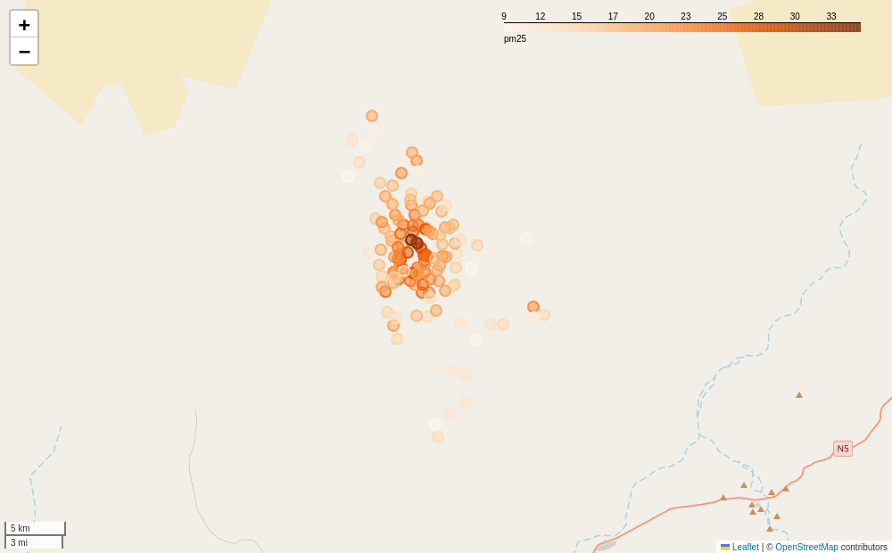

# Raport z zadania 2
## Cel ćwiczenia
Celem ćwiczenia było zapoznanie się z biblioteką **GeoPandas**: utworzenie prostych geometrii i `GeoDataFrame`, a następnie wczytanie, oczyszczenie i wizualizacja pomiarów PM2.5 z czujników w Opolu.

## Przebieg ćwiczenia

### Przygotowanie środowiska
Pracę wykonano w notatniku `lab_geopandas.ipynb` (środowisko conda `geoinf`, Python 3.11). Sprawdzono wersje bibliotek: **geopandas 1.2.0**, **rasterio 1.4.4** (GDAL 3.12.4), **shapely 2.1.2**.

### A1. Geometria i GeoDataFrame od zera
W **Shapely** utworzono punkt `rynek` (17,9226; 50,6681) i kwadrat `square` o boku 0,01°. Współrzędne podaje się w kolejności **(x, y) = (lon, lat)**.
- `square.area` = `0.0001`, czyli pole w stopniach kwadratowych, bez interpretacji fizycznej,
- `square.contains(rynek)` = `True`.

Z obu geometrii zbudowano `GeoDataFrame` w układzie `EPSG:4326` (WGS 84). Jedna warstwa zawiera geometrie typu `Point` i `Polygon`.

### A2. Wczytanie surowych danych
Plik `dane/pm25_sensors.csv` (145 wierszy; kolumny `sensor_id`, `lat`, `lon`, `pm25`, `measured_at`) wczytano przez `pd.read_csv`. Analiza `describe()`, `isna()` i `duplicated()` wykazała:
- 5 duplikatów,
- braki współrzędnych (3 × `lat`, 4 × `lon`),
- zamienione współrzędne (min `lat` = 17,87, max `lon` = 50,68),
- kod błędu `-999` w `pm25`, przez który średnia wynosiła −8,99 µg/m³.

### A3. Czyszczenie danych
1. `drop_duplicates()`: 145 → 140 wierszy.
2. `dropna(subset=["lat", "lon"])`: 140 → 134.
3. Naprawa zamienionych współrzędnych (`lat` w zakresie 14–24,5 i `lon` w zakresie 49–55): poprawiono 3 wiersze.
4. Usunięcie `pm25 < 0`: 134 → **130**.

Po czyszczeniu: `pm25` średnio 18,86 µg/m³ (mediana 19,0; zakres 9,2–35,3), wszystkie punkty w obrębie Opola.

### A4. Z tabeli do GeoDataFrame
Warstwę punktową utworzono przez `gpd.points_from_xy(df["lon"], df["lat"])` w układzie `EPSG:4326`. Zasięg (`total_bounds`) wynosi `[17.786, 50.617, 18.020, 50.768]`. Metodą `explore()` wyświetlono ją na interaktywnej mapie, kolorując punkty według `pm25` (paleta `Oranges`) (Rys. 1).

*Rys. 1. Czujniki PM2.5 po oczyszczeniu, `sensors.explore()`.*

W warstwie `sensors2` celowo zamieniono kolejność argumentów (`points_from_xy(df["lat"], df["lon"])`). Punkty trafiły w okolice Półwyspu Arabskiego (ok. 50,7° E, 17,9° N), a GeoPandas nie zgłosił żadnego błędu (Rys. 2).

*Rys. 2. Ta sama warstwa z zamienionymi współrzędnymi, `sensors2.explore()`.*

## Wyniki i wnioski
Ze 145 surowych rekordów uzyskano 130 poprawnych pomiarów PM2.5. Najwyższe stężenia występują w centrum Opola (Rys. 1).
- **Kolejność współrzędnych:** GeoPandas oczekuje (lon, lat). Pomyłka nie powoduje błędu programu, tylko przesuwa punkty o tysiące kilometrów, dlatego wynik trzeba sprawdzić na mapie.
- **Kontrola jakości:** wartości specjalne (`-999`) całkowicie zafałszowują statystyki. Zakres współrzędnych obszaru pozwala łatwo wykryć błędne rekordy.
- **Jednostki:** w EPSG:4326 pole wychodzi w stopniach kwadratowych. Do pomiarów potrzebny jest układ metryczny, np. EPSG:2180.
