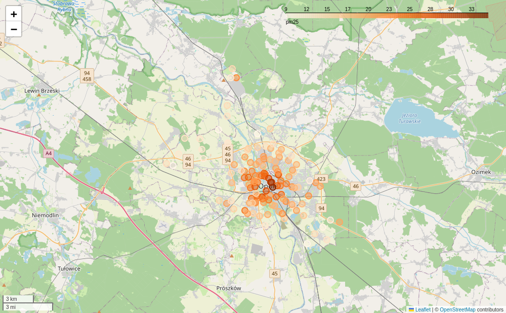
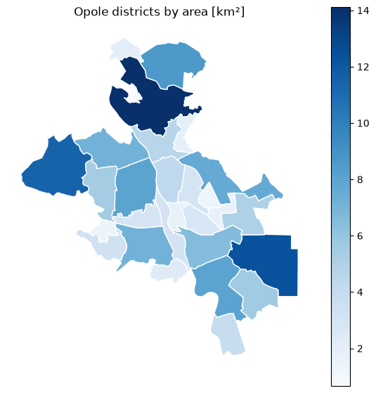
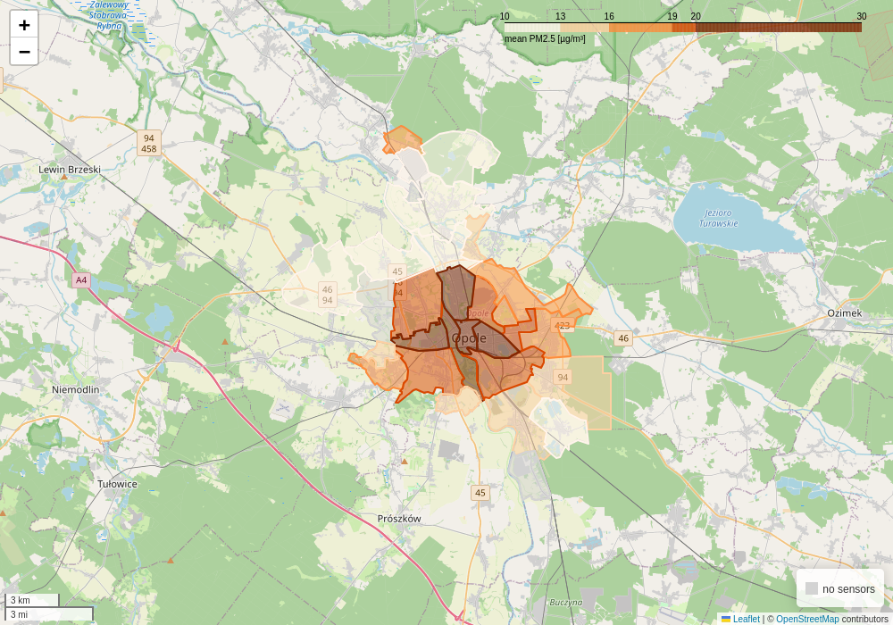
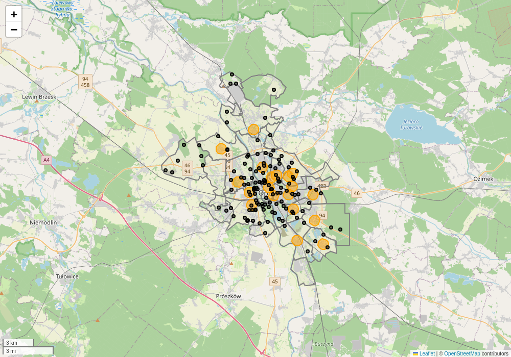

# Raport z zadania 2
## Cel ćwiczenia
Celem ćwiczenia było zapoznanie się z biblioteką **GeoPandas** na przykładzie pomiarów PM2.5 z czujników w Opolu. Analiza miała odpowiedzieć na dwa pytania:
1. Które dzielnice Opola mają najgorsze powietrze?
2. Jak wygląda sytuacja w pobliżu szkół podstawowych?

## Przebieg ćwiczenia

### Przygotowanie środowiska
Pracę wykonano w notatniku `lab_geopandas.ipynb` (środowisko conda `geoinf`, Python 3.11). Sprawdzono wersje bibliotek: **geopandas 1.2.0**, **rasterio 1.4.4** (GDAL 3.12.4), **shapely 2.1.2**.

### A1. Geometria i GeoDataFrame od zera
W **Shapely** utworzono punkt `rynek` (17,9226; 50,6681) i kwadrat `square` o boku 0,01°. Współrzędne podaje się w kolejności **(x, y) = (lon, lat)**.
- `square.area` = `0.0001`, czyli pole w stopniach kwadratowych, bez interpretacji fizycznej,
- `square.contains(rynek)` = `True`.

Z obu geometrii zbudowano `GeoDataFrame` w układzie `EPSG:4326` (WGS 84). Jedna warstwa zawiera geometrie typu `Point` i `Polygon`.

### A2. Wczytanie surowych danych
Plik `dane/pm25_sensors.csv` (145 wierszy; kolumny `sensor_id`, `lat`, `lon`, `pm25`, `measured_at`) wczytano przez `pd.read_csv`. Analiza `describe()`, `isna()` i `duplicated()` wykazała:
- 5 duplikatów,
- braki współrzędnych (3 × `lat`, 4 × `lon`),
- zamienione współrzędne (min `lat` = 17,87, max `lon` = 50,68),
- kod błędu `-999` w `pm25`, przez który średnia wynosiła −8,99 µg/m³.

### A3. Czyszczenie danych
1. `drop_duplicates()`: 145 → 140 wierszy.
2. `dropna(subset=["lat", "lon"])`: 140 → 134.
3. Naprawa zamienionych współrzędnych (`lat` w zakresie 14–24,5 i `lon` w zakresie 49–55): poprawiono 3 wiersze.
4. Usunięcie `pm25 < 0`: 134 → **130**.

Po czyszczeniu: `pm25` średnio 18,86 µg/m³ (mediana 19,0; zakres 9,2–35,3), wszystkie punkty w obrębie Opola.

Zamienione współrzędne dało się naprawić, bo poprawna wartość jest w rekordzie, tylko w złej kolumnie. Kod `-999` nie niesie żadnej informacji o stężeniu, więc te wiersze trzeba było usunąć. W kroku 3 potrzebne jest `.to_numpy()`: bez niego pandas dopasowuje kolumny po nazwach i zamiana nie zachodzi (3 wiersze zostają błędne).

### A4. Z tabeli do GeoDataFrame
Warstwę punktową utworzono przez `gpd.points_from_xy(df["lon"], df["lat"])` w układzie `EPSG:4326`. Zasięg (`total_bounds`) wynosi `[17.786, 50.617, 18.020, 50.768]`. Metodą `explore()` wyświetlono ją na interaktywnej mapie, kolorując punkty według `pm25` (paleta `Oranges`) (Rys. 1).

*Rys. 1. Czujniki PM2.5 po oczyszczeniu, `sensors.explore()`.*

W warstwie `sensors2` celowo zamieniono kolejność argumentów (`points_from_xy(df["lat"], df["lon"])`). Punkty trafiły w okolice Półwyspu Arabskiego (ok. 50,7° E, 17,9° N), a GeoPandas nie zgłosił żadnego błędu (Rys. 2).

*Rys. 2. Ta sama warstwa z zamienionymi współrzędnymi, `sensors2.explore()`.*

### A5. Układy współrzędnych
Odległość między dwoma pierwszymi czujnikami w EPSG:4326 wynosi `0.0453`, czyli stopnie, a nie jednostki długości. Po przejściu do układu **PUWG 1992 (EPSG:2180)** metodą `to_crs()` wynosi **4906 m**. Współrzędne w EPSG:2180 są rzędu setek tysięcy metrów (np. `POINT (422754.5 312637.2)`).

Porównano odległość Gdańsk–Zakopane w różnych układach. Punktem odniesienia była odległość geodezyjna na elipsoidzie WGS 84, policzona przez `pyproj.Geod`:

| Układ | Odległość [km] | Błąd |
|---|---|---|
| geodezyjna (WGS 84) | 569,3 | – |
| EPSG:2180 (PUWG 1992) | 568,9 | −0,07% |
| EPSG:3857 (Web Mercator) | 922,8 | +62,09% |

Web Mercator rozciąga odległości o czynnik 1/cos(φ), czyli ok. 1,62 dla szerokości Polski. Nadaje się do wyświetlania kafli mapy, a nie do pomiarów.

### A6. Poligony: dzielnice Opola
Plik `opole_districts.geojson` wczytano przez `gpd.read_file`: **29 dzielnic** w układzie EPSG:4326. Po przejściu do EPSG:2180 policzono powierzchnię w km². Całe miasto ma **148,8 km²**. Największa dzielnica to Czarnowąsy (14,1 km²), a najmniejsza Borki (0,66 km²) (Rys. 3).

Bez `to_crs()` suma `.area` wynosi `0.019` stopnia kwadratowego. GeoPandas wyświetla wtedy ostrzeżenie *„Geometry is in a geographic CRS. Results from 'area' are likely incorrect”*.

*Rys. 3. Dzielnice Opola według powierzchni [km²], `districts.plot()`.*

### A7. Złączenie przestrzenne
Każdemu czujnikowi przypisano dzielnicę złączeniem przestrzennym `gpd.sjoin(..., predicate="within")`. Obie warstwy były w EPSG:2180. Wszystkie **130 czujników** znalazło dzielnicę. **3 dzielnice** (Bierkowice, Borki, Grotowice) nie mają żadnego czujnika.

Następnie policzono średnie `pm25` i liczbę czujników w każdej dzielnicy (`groupby`), a wynik dołączono do poligonów (`merge`). Średnia z jednego czujnika jest mało wiarygodna, więc ranking ograniczono do dzielnic z co najmniej 3 czujnikami (17 dzielnic):

| Dzielnica | Średnie PM2.5 [µg/m³] | Liczba czujników |
|---|---|---|
| Stare Miasto | 29,6 | 3 |
| Śródmieście | 26,8 | 7 |
| Zaodrze | 22,5 | 6 |

Najczystsze powietrze mają Sławice (11,5), Wrzoski (12,1) i Malina (12,4). Wynik przedstawiono na kartogramie z podziałem kwantylowym na 5 klas (`scheme="quantiles"`) (Rys. 4).

*Rys. 4. Średnie PM2.5 w dzielnicach Opola, `summary.explore()`. Dzielnice bez czujników: kolor szary.*

Zmiana predykatu na `intersects` nie zmieniła wyniku. Dla punktów oba predykaty różnią się tylko wtedy, gdy punkt leży dokładnie na granicy poligonu. Dla linii lub poligonów przecinających granice dzielnic różnica byłaby duża.

### A8. Bufory
Wokół 19 szkół podstawowych (`opole_schools.geojson`) wyznaczono bufory o promieniu **500 m** (`buffer(500)` w EPSG:2180) i złączono je z czujnikami:
- **11 z 19 szkół** ma czujnik w promieniu 500 m,
- średnie PM2.5 przy szkołach wynosi **22,3 µg/m³**, wyraźnie więcej niż średnia dla miasta (18,9 µg/m³),
- połączone bufory (`union_all()`) przycięte do granic miasta pokrywają **9,5%** jego powierzchni.

Warstwy dzielnic, buforów i czujników nałożono na jedną mapę kolejnymi wywołaniami `explore(m=m)` (Rys. 5).

*Rys. 5. Dzielnice (szary), bufory 500 m wokół szkół (pomarańczowy) i czujniki (czarny).*

Po zwiększeniu promienia do 1500 m czujnik w pobliżu ma **każda z 19 szkół**, a bufory pokrywają 50,4% miasta. Ten sam `buffer(1500)` w EPSG:4326 dałby promień 1500 **stopni**: bufory objęłyby całą kulę ziemską (zasięg ok. ±1500° zamiast kilku km), a GeoPandas zgłosiłby tylko ostrzeżenie.

### A9. Zapis wyników
Wyniki zapisano w katalogu `wyniki/`:
- `pm25.gpkg` (GeoPackage): dwie warstwy w jednym pliku, `districts` (29 poligonów ze statystykami PM2.5) i `sensors` (130 punktów), obie w EPSG:2180,
- `pm25_districts.geojson`: warstwa dzielnic w EPSG:4326, bo tego układu oczekują aplikacje webowe.

`gpd.list_layers` potwierdziło obie warstwy GeoPackage, a ponownie wczytana warstwa `districts` ma 29 wierszy i CRS EPSG:2180.

## Wyniki i wnioski
Ze 145 surowych rekordów uzyskano 130 poprawnych pomiarów PM2.5. Odpowiedzi na pytania z celu ćwiczenia:
1. **Najgorsze powietrze** jest w centrum miasta: Stare Miasto (29,6 µg/m³), Śródmieście (26,8) i Zaodrze (22,5). Najczystsze są dzielnice peryferyjne, np. Sławice i Wrzoski.
2. **Przy szkołach** średnie PM2.5 (22,3 µg/m³) jest wyższe od średniej miejskiej (18,9 µg/m³), co wynika z tego, że wiele szkół leży w centrum. Czujnik w promieniu 500 m ma jednak tylko 11 z 19 szkół.

Najważniejsze wnioski z ćwiczenia:
- **Kolejność współrzędnych:** GeoPandas oczekuje (lon, lat). Pomyłka nie powoduje błędu programu, tylko przesuwa punkty o tysiące kilometrów, dlatego wynik trzeba sprawdzić na mapie.
- **Kontrola jakości:** wartości specjalne (`-999`) całkowicie zafałszowują statystyki. Zakres współrzędnych obszaru pozwala łatwo wykryć błędne rekordy.
- **Dobór układu współrzędnych:** dane przechowuje się w EPSG:4326, a odległości, powierzchnie i bufory liczy w układzie metrycznym właściwym dla obszaru (w Polsce EPSG:2180). EPSG:3857 służy tylko do wyświetlania (błąd odległości +62%).
- **Typowy schemat pracy z danymi wektorowymi:** `read_csv` → czyszczenie → `GeoDataFrame` → `to_crs` → `read_file` → `sjoin` / `buffer` → `to_file`.
